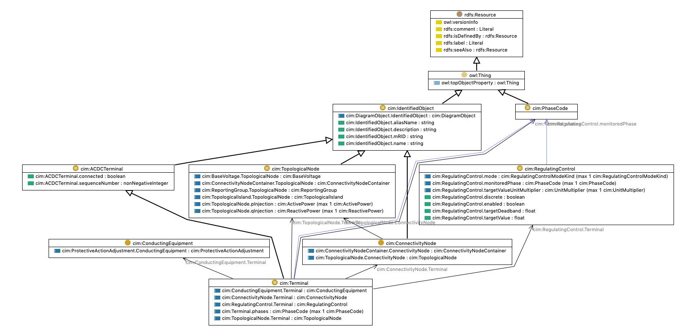

# Model Representation

Figure below shows an UML diagram for `Terminal` and `ConnectivityNode` in Common Information Model (CIM) which is used to connect terminals of 
ac conducting equipment which is analogous to `DistributionBus` in grid data models. [The CIM diagram is accessed from here.](https://ontology.tno.nl/IEC_CIM/cim_Terminal.html). `Terminal` class inherits from `IdentifiedObject` class which has `name`, `description` and `mrid`. In GDM, component IDs are System-scoped integers and are not equivalent to a globally stable CIM `mrid`. `System.uuid` identifies the System, not an individual component. Also `DistributionBus` has `coordinate` attribute of type `Location` which is equivalent to `PositionPoint` in CIM.


| GDM | CIM | Note |
|-----|-----|------|
|`Component.name`| `cim:IdentifiedObject.name`| Both of them are string. |
| `Component.id` | N/A | Integer identifier scoped to its owning System. |
| `System.uuid` | N/A | UUID identifying the System. |
| `DistributionBus.rated_voltage` | `cim:BaseVoltage.ratedVoltage` | Note rated voltage is unit aware but BaseVoltage is not. |
| `Location.x` | `cim:PositionPoint.xPosition` | x coordinate of the component. |
| `Location.y` | `cim:PositionPoint.yPosition` | y coordinate of the component |
| `Location.crs` | N/A | Coordinate reference system for geo coordinates. |
| `DistributionBus.voltage_type` | N/A | Differentiates from line to line voltage to line to ground voltage |
| `DistributionComponentBase.feeder` |  | Feeder containing this component. |
| `DistributionComponentBase.substation` |  | Substation containing this component. |
| `DistributionBus.phases` | `cim:Terminal.phases`| List of phases.| 
| `VoltageLimitSet.limit_type` | | Limit type min or max |
| `VoltageLimitSet.value` | | Value for limit. |



Here is an UML diagram of `DistributionBus` from Grid data models.

```{mermaid}

    classDiagram

      class Component
      Component: +name str
      Component: +id int | None

      class System
      System: +uuid UUID

      class Location
      Location: +x float
      Location: +y float 
      Location: +crs str | None

      class DistributionComponentBase
      DistributionComponentBase: +substation DistributionSubstation | None
      DistributionComponentBase: +feeder DistributionFeeder | None

      class InServiceDistributionComponentBase
      InServiceDistributionComponentBase: +in_service bool

      class DistributionBus
      DistributionBus: +voltage_type VoltageTypes
      DistributionBus: +phases list[Phase]
      DistributionBus: +voltagelimits list[VoltageLimitSet]
      DistributionBus: +rated_voltage Voltage
      DistributionBus: +coordinate Location | None

      class VoltageTypes{
        <<enumeration>>
        LINE_TO_LINE
        LINE_TO_GROUND
      }

      class Phase{
        <<enumeration>>
        A
        B
        C
        N
        s1
        s2
      }

      class VoltageLimitSet
      VoltageLimitSet: +limit_type LimitType
      VoltageLimitSet: +value PositiveVoltage

      class LimitType{
        <<enumerations>>
        MIN
        MAX
      }

      Component <|-- DistributionComponentBase
      DistributionComponentBase <|-- InServiceDistributionComponentBase
      InServiceDistributionComponentBase <|-- DistributionBus
      DistributionBus --> Location
      VoltageLimitSet "0..*" --> "1" DistributionBus
```
